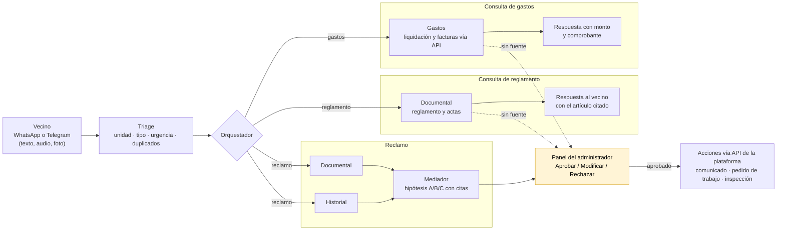

# DISCOVERY — ![][image1]Eliseo

> Sistemas Multiagentes I (72.79) · ITBA   
---

## 0\. Resumen ejecutivo

En CABA casi 3 de cada 4 viviendas son departamentos *\[F1\]* y los administradores de consorcios acumularon 2.943 denuncias ante Defensa al Consumidor en 2024, una de cada cuatro por mal mantenimiento de los espacios comunes *\[F23\]*. Las plataformas de gestión (AdminProp, ConsorcioAbierto) digitalizaron expensas y pagos, pero los vecinos siguen reclamando y preguntando por WhatsApp, por fuera del sistema *\[F12\]*, y nadie automatiza la parte cara: **decidir a quién le corresponde un reclamo y fundamentarlo** con el reglamento, las actas y los antecedentes. Proponemos un asistente multiagente en **WhatsApp y Telegram**, vendido a esas plataformas y conectado a sus datos, donde el vecino hace reclamos y consulta el reglamento, los gastos y las facturas con la fuente citada. Ante reclamos de responsabilidad, redacta un **dictamen con hipótesis citadas** (o recomienda inspección) que el administrador aprueba, modifica o rechaza.   
---

## 1\. Business Value Map

### 1.1 Mercado

**Mercado específico:** software de gestión para administraciones de consorcios de propiedad horizontal en Argentina, con foco inicial en CABA y AMBA. Nuestro cliente directo son las plataformas (B2B); sus clientes son las administraciones matriculadas.

**Tamaño (proxies con fuente):**

| Indicador | Valor | Fuente |
| :---- | :---- | :---- |
| Viviendas particulares ocupadas en CABA que son departamentos | 73,7% (vs. 19,6% en el total del país) | Censo 2022, DGEyC-GCBA *\[F1\]* |
| Viviendas habitadas con moradores presentes, CABA | 1.391.258 | *\[F1\]* |
| Departamentos ocupados en CABA (cálculo propio: 73,7% × 1.391.258) | ≈ 1,03 millones de unidades | derivado de *\[F1\]* |
| Hogares en CABA, variación 2010–2022 | \+22,3% | *\[F1\]* |
| Cuentas "consorcio" en Banco Ciudad, 2024 | 10.425 (+20,7% interanual) | pedido de información pública citado en *\[F3\]* |
| Cantidad de consorcios en CABA | **\[Supuesto\]** decenas de miles | Validar con el dataset público del RPA *\[F4\]* y un pedido de acceso a la información (Ley 104\) |

**Crecimiento:** no encontramos un informe de mercado con tasa de crecimiento del software para consorcios. La mejor estimación es **creciente moderado**, apoyada en tres proxies: más hogares en PH *\[F1\]*, más cuentas bancarias de consorcio *\[F3\]* y la formalización de la actividad (registro provincial en marcha desde 2023 *\[F5\]*, depuración de matrículas en CABA *\[F6\]*). 

**Fuerzas que pueden redefinirlo (1–3 años):**

| A favor | En contra |
| :---- | :---- |
| Desde abril de 2025 el administrador en CABA debe acercar el Reglamento y el Manual de Buenas Prácticas a cada liquidación (QR o link) *\[F7\]*: más vecinos leen el reglamento → más consultas que hay que responder bien. | La Ley 941 prevé una **Aplicación Oficial** de uso obligatorio para administradores onerosos *\[F8\]*; si el GCBA la implementa con fuerza, puede comoditizar parte de las plataformas. |
| Profesionalización: examen de idoneidad para nuevos matriculados *\[F9\]* y bajas masivas de matrículas desactualizadas *\[F6\]* → más presión de compliance y documentación. | Se supone que el contexto de expensas altas: el administrador es muy sensible a sumar costos por UF . |
| La Ciudad empuja la adopción de IA en su propia gestión (Decreto 97/2026) *\[F10\]*: normaliza la IA frente al vecino. | Ley 25.326 de Protección de Datos Personales *\[F11\]*: reclamos con fotos, deudas y conflictos son datos sensibles a cuidar. |
| Las denuncias ante Defensa al Consumidor CABA crecieron 20,7% interanual en el 1er semestre de 2024 y los administradores quedaron 3º entre los rubros más denunciados *\[F2\]*: más presión para documentar y fundamentar decisiones. | Competencia: plataformas nuevas centradas en reclamos (p. ej., Octavo Piso *\[F12\]*) y prototipos de asistentes IA para consorcios. |
| WhatsApp llega a \~99% de los usuarios de Argentina y 66% ya contrató un servicio por ese canal *\[F24\]*: el vecino ya reclama ahí. | Dependencia de Meta: desde el 15/1/2026 la API de WhatsApp prohíbe los chatbots de IA generalistas (los de atención de un negocio siguen permitidos) \[F25\], y desde el 1/10/2026 cobra los mensajes utility y los de servicio por encima de 1.000 por mes \[F26\]. |

### 1.2 Modelo de negocio

| Pregunta | Plataforma socia (AdminProp / ConsorcioAbierto) | Nuestro módulo |
| :---- | :---- | :---- |
| Etapa | **Escala/madurez**: AdminProp declara más de 10 años en el sector \[F13\]; ConsorcioAbierto tenía presencia en más de 40 ciudades ya hace años \[F14\]. | Seed (producto nuevo sobre canal existente). |
| Cómo genera dinero | Suscripción cobrada **por unidad funcional** (documentado para ConsorcioAbierto \[F14\]). | Add-on por UF activada o revenue share con la plataforma. |
| Tipo | B2B: paga la administración; usan administrador, auxiliares y vecinos (apps de vecinos \[F15\]\[F16\]). | B2B2B2C: nos paga la plataforma → le cobra a la administración → lo usan el administrador (panel) y los vecinos (WhatsApp/Telegram). |

**Cómo defiende el motor de revenue en esta etapa:** En madurez, la mayoría de las administraciones que podíamos captar ya son clientes. Por eso el revenue ya no crece sumando clientes nuevos, sino reteniendo las administraciones actuales y aumentando el ingreso por UF.

El módulo aporta a las dos cosas. Por un lado, retiene: resuelve la tarea que más desgasta al administrador y ataca las causas de denuncia que lo exponen \[F2\]\[F23\], lo que reduce sus motivos para cambiar de sistema. Por otro lado, expande el **Average Revenue Per User (ARPU)**, ya que se vende como un add-on opcional que se cobra por UF, sin tocar el core contable.

Además, no distrae del foco del producto. No reemplaza expensas, cobranzas ni contabilidad: lee y escribe en los módulos que ya existen (reclamos, documentos y liquidaciones).

### 1.3 Diferenciación (Blue Ocean)

| Acción | Ejemplo concreto |
| :---- | :---- |
| **Eliminar** | El reclamo informal por WhatsApp que el administrador tiene que retipear y completar ("¿qué piso?, ¿mandame foto?, ¿desde cuándo?"): el chat del vecino entra solo al sistema, ya estructurado. |
| **Reducir** | El tiempo que el administrador pasa buscando qué artículo aplica a un balcón o una mascota, o en qué factura está un gasto que un vecino pregunta. |
| **Elevar** | La trazabilidad: toda respuesta indica el artículo del reglamento o el acta de donde sale. |
| **Crear** | Un canal donde el vecino pregunta qué dice el reglamento o en qué se gastó su expensa y recibe la fuente, y un dictamen de responsabilidad neutral con hipótesis (unidad / común / evidencia insuficiente) aprobado por el administrador. |

**Diferenciadores de las plataformas vs. nuestro feature:**

| Diferenciador de la plataforma | Efecto del módulo |
| :---- | :---- |
| Transparencia en la relación administrador–vecino (origen de ConsorcioAbierto \[F14\]) | **Amplifica**: el vecino ve el artículo, la línea de la liquidación o la factura de donde sale cada respuesta. |
| Sencillez de uso para administración y vecinos \[F14\] | **Amplifica** si el chat es una puerta de entrada a la plataforma: el vecino usa el WhatsApp que ya tiene, sin descargar otra app, y cada conversación queda como reclamo en el sistema del administrador. Lo **contradiría** un chatbot desconectado que arme un canal paralelo → descartado. |
| Integraciones y automatización operativa (imputación de pagos, pedidos y trabajos \[F13\]) | **Amplifica**: el dictamen aprobado dispara el pedido de trabajo ya existente. |
| Control del administrador sobre lo que se comunica | **Defiende**: las consultas con fuente se responden solas; asignar responsabilidad o comunicar algo en nombre del consorcio requiere su aprobación. |

**Punto de control:** Mercado ✔ · Modelo ✔ · Diferenciación ✔.

---

## 2\. Feature Value Map

Aplica: agregamos IA a productos existentes.

**Clientes (quién compra):**

- Comprador directo de nuestro módulo: la **plataforma** (decisor: producto/CEO). Prioridades: ARPU, churn, diferenciación frente a competidores, costo de soporte.  
- Comprador final de la plataforma: la **administración matriculada en el RPA** (decisor: el administrador titular). Prioridades: ahorrar horas, respaldo ante reclamos y denuncias, control.

**Usuarios (quién lo usa más):** administrador y auxiliares administrativos (procesan el caso) y vecinos propietarios e inquilinos (lo inician desde WhatsApp o Telegram). **Persona de mayor palanca: el administrador**, porque es quien paga por UF y quien decide renovar.

**Producto actual (features relevantes, relevadas de las fichas públicas de las apps):**

| Feature existente | Necesidad que cubre | Contribución al revenue |
| :---- | :---- | :---- |
| Liquidación de expensas y cuenta corriente \[F13\]\[F15\] | Cumplir la obligación central del administrador | Core: justifica el cobro por UF |
| Pago online, informe de pago e imputación automática \[F13\]\[F16\] | Cobrar sin conciliar a mano | Retención y diferenciación |
| Reclamos/pedidos con fotos y seguimiento \[F15\]\[F16\] | Canalizar pedidos de vecinos | Valor percibido por el vecino; hoy es un formulario |
| Comunicados individuales y masivos \[F17\] | Avisos (obras, cortes) | Reduce trabajo operativo |
| Repositorio de reglamentos, actas y presupuestos \[F15\] | Acceso a documentación | Compliance (Disp. 521/2025 \[F7\]) |
| Votaciones online \[F16\] | Decisiones sin asamblea presencial | Diferenciación |
| Reservas de amenities, accesos QR, conserjería \[F15\] | Operación diaria | Upsell en edificios grandes |

**Comprador vs. usuario:** el administrador quiere **respaldo y control** (que nada salga sin su firma, que la respuesta resista una denuncia); el vecino quiere **rapidez y sentirse escuchado**. La IA tiene que comportarse distinto para cada uno: hacia el vecino, en el chat, acuse inmediato, pedido de evidencia faltante y respuestas a consultas de reglamento, gastos y facturas **solo cuando puede citar la fuente** (si no, deriva al administrador); toda decisión de responsabilidad o comunicación en nombre del consorcio es un **borrador en el panel del administrador** con Aprobar / Modificar / Rechazar. Cada vecino se identifica por el teléfono registrado en la plataforma y ve solo su cuenta corriente y los gastos de su consorcio.

**Riesgo de canibalización y cómo lo evitamos:**

| Feature simple que podría degradarse | Riesgo | Mitigación |
| :---- | :---- | :---- |
| App de vecinos y formulario de reclamos | El chat en WhatsApp puede vaciar la app de la plataforma y es menos predecible que un formulario | El triage **completa** el reclamo estructurado en el mismo módulo; pagos, reservas y votaciones siguen en la app, y el chat deriva a ella con un link. |
| Imputación automática de pagos | Ya funciona por integración bancaria \[F13\] | No la tocamos. El "informar pago" del vecino solo se usa donde no hay integración, y la extracción del comprobante se valida contra el movimiento bancario. |
| Votaciones online | Ya existen \[F16\] | Nuestro agente solo **calcula qué mayoría exige el reglamento** y crea la votación en el módulo existente. |
| Comunicados | Dos canales oficiales confundirían al vecino | Los comunicados masivos siguen saliendo por la plataforma; el chat solo responde y avisa el estado de los casos de cada vecino. |

---

## 3\. User Value Map

### Paso 1 — Persona

**Laura, administradora matriculada en el RPA de CABA**. \[supuesto\]

- **Contexto:** administra \~25 consorcios (\~600 UF) con 2 auxiliares. Usa AdminProp o ConsorcioAbierto para expensas y cobranzas; los reclamos le llegan por la app, mail, WhatsApp y llamadas.  
- **Objetivos:** resolver rápido, que la asamblea la renueve, no recibir denuncias ante Defensa al Consumidor.  
- **Herramientas:** plataforma de gestión, WhatsApp, Gmail, PDFs escaneados del reglamento y libro de actas, planilla de proveedores.

### Paso 2 y 3 — Journey "gestionar un reclamo de punta a punta"

|  | 1\. Recepción | 2\. Encuadre | 3\. Respuesta / mediación | 4\. Gestión técnica | 5\. Decisión | 6\. Ejecución y cierre | 7\. Rendición |
| :---- | :---- | :---- | :---- | :---- | :---- | :---- | :---- |
| **Hace** | Lee el reclamo, pide datos y fotos, lo carga | Busca en reglamento, actas e historial a quién corresponde | Contesta al vecino; si hay dos partes, intenta acercarlas | Pide presupuestos, coordina visita | Si excede sus facultades, lleva a votación/asamblea | Ordena el trabajo, avisa, cierra | Imputa el gasto, informa en el acta |
| **Piensa** | "¿Es urgente o puede esperar?" | "¿Es de la unidad o es común? Si me equivoco, me lo reclaman a mí" | "Diga lo que diga, alguno va a pensar que tomo partido" | "¿Cuál de los tres presupuestos conviene?" | "¿Qué mayoría hace falta?" | "¿Se resolvió de verdad?" | "Que cierre con lo aprobado" |
| **Siente** | Saturación | Inseguridad | Exposición | Fastidio | Incertidumbre | Alivio / culpa por lo pendiente | Control |

### Paso 4 — Pain-points (lista completa, antes del filtro)

| ID | Etapa | Pain-point concreto | Evidencia |
| :---- | :---- | :---- | :---- |
| P1 | Recepción | El mismo reclamo llega por WhatsApp, mail o llamada y hay que retipearlo en la plataforma; los que llegan fuera de la app se pierden. | Plataforma de reclamos reporta ese problema de dispersión \[F12\]; WhatsApp llega a \~99% de los usuarios en Argentina \[F24\] |
| P2 | Recepción | Ante un corte de agua, varios vecinos reportan lo mismo por canales distintos y hay que contestar uno por uno. | \[supuesto\] |
| P3 | Recepción | Un aviso de olor a gas a la noche queda en la misma bandeja que una lamparita quemada. | \[supuesto\] |
| P4 | Encuadre | Para responder "¿puedo poner un toldo / tener un perro / alquilar temporario?" hay que encontrar el artículo en un reglamento escaneado y en actas que lo modificaron. | Reglamento ahora obligatorio en cada liquidación → más consultas \[F7\] |
| P5 | Encuadre | En filtraciones y humedad, decidir si es unidad o común exige cruzar reglamento, planos e historial; si decide mal, el reclamo vuelve contra el administrador. | Filtraciones \= 30% de \~19.700 reclamos analizados \[F12\]; el mal mantenimiento de espacios comunes es \~25% de las 2.943 denuncias de 2024 contra administradores \[F23\]; tema típico de mediación en CABA \[F18\] |
| P6 | Respuesta | En conflictos entre vecinos (cocheras, mascotas, ruidos, espacios comunes) la respuesta varía según qué auxiliar conteste y una parte acusa parcialidad. | Estas categorías suman \~41% de los reclamos \[F12\]; la mediación comunitaria del GCBA recibe estos casos \[F18\] |
| P7 | Gestión | Pedir 3 presupuestos por mail, insistir a quien no contesta y comparar PDFs con formatos distintos. | \[supuesto\] |
| P8 | Gestión | Coordinar la visita del plomero con la disponibilidad del vecino lleva varios mensajes. | \[supuesto\] |
| P9 | Decisión | Calcular qué mayoría exige el reglamento/CCyC (art. 2060 \[F19\]) y contar votos por UF y por coeficiente. | Doble cómputo del art. 2060 \[F19\] |
| P10 | Ejecución | Reclamos sin seguimiento: el vecino escala diciendo "nadie me contestó" o que no se ejecutó lo votado. | No ejecutar decisiones de asamblea es la 2ª causa de denuncia en CABA \[F2\]\[F23\] |
| P11 | Rendición | Vecinos preguntan por qué subió la expensa o cuánto se pagó por un arreglo, o piden la factura o el acta: hay que buscarlo en la liquidación y los comprobantes. | Falta de acceso a documentación \= 18,2% de las denuncias contra administradores en el 1er semestre de 2024; las irregularidades en la liquidación por falta de información también están entre las 5 principales \[F2\] |
| P12 | Rendición | Redactar el acta y el resumen de casos para la asamblea anual. | \[supuesto\] |
| P13 | Rendición | Prorratear cada gasto por coeficiente en la liquidación. | Funcionalidad estándar del software \[F20\] |
| P14 | Ejecución | Imputar pagos informados por el vecino con comprobante. | Ya cubierto por integraciones \[F13\] |

### Paso 5 — Subconjunto AI-solvable

Filtro: ¿la persona transforma información de un formato a otro con un proceso repetible que un humano inteligente podría hacer con un brief?

| ID | ¿AI-solvable? | Patrón | Por qué |
| :---- | :---- | :---- | :---- |
| P1 | ✅ | Traducción | Texto/audio/foto libre → reclamo estructurado (unidad, tipo, ubicación). |
| P2 | ✅ | Escala | Agrupar mensajes semánticamente iguales. |
| P3 | ✅ | Consistencia | Misma regla de urgencia para todos, explicable. |
| P4 | ✅ | Expertise \+ Traducción | Leer el reglamento y responder en lenguaje vecinal con cita. |
| P5 | ✅ | Expertise \+ Consistencia | Razonar sobre texto dado (reglamento, actas, historial) y producir hipótesis. |
| P6 | ✅ | Consistencia \+ Expertise | Propuesta neutral basada en reglas y precedentes, igual sin importar quién atienda. |
| P7 | ✅ | Escala \+ Traducción | Redactar pedidos y extraer montos/plazos de PDFs heterogéneos. |
| P11 | ✅ | Traducción \+ Escala | Pregunta en el chat → línea de la liquidación o factura recuperada; los montos salen de la base de la plataforma, no del LLM. |
| P12 | ✅ | Traducción | Casos del período → borrador de acta. |
| P8 | ❌ (parcial) | — | Es un problema de agenda: ingeniería (slots y confirmación). El LLM solo interpreta "puedo martes a la tarde". |
| P9 | ❌ (parcial) | — | El cómputo exige exactitud: motor determinístico. El LLM solo extrae del reglamento qué mayoría aplica. |
| P10 | ❌ | — | Timers y escalamiento: workflow/ingeniería. |
| P13 | ❌ | — | Aritmética con coeficientes: ya lo resuelve el software contable. |
| P14 | ❌ | — | Integración bancaria/RPA; ya existe \[F13\]. |

---

## 4\. Priorización de pain-points (Frecuencia × Severidad)

Frecuencia \= veces por semana para una administradora con \~25 consorcios. Severidad \= costo cuando aparece (tiempo, riesgo de denuncia, conflicto).

| ID | F | S | F×S | Cuadrante | Justificación |
| :---- | :---- | :---- | :---- | :---- | :---- |
| **P5** | 6 | 9 | **54** | Alta/Alta → primero | 30% de los reclamos son filtraciones o daños entre unidades \[F12\] y \~25% de las denuncias contra administradores en 2024 fueron por mal mantenimiento de espacios comunes \[F23\]; si asigna mal, paga el consorcio indebidamente o el administrador queda expuesto (el art. 2067 CCyC lo obliga a conservar las partes comunes \[F19\]). F=6 **\[Supuesto\]**. |
| **P4** | 8 | 6 | **48** | Alta/Alta | La obligación de acercar el reglamento en cada liquidación \[F7\] multiplica preguntas puntuales; cada una exige leer documentos largos. F **\[Supuesto\]**. |
| **P6** | 5 | 8 | **40** | Alta/Alta | \~41% de los reclamos son de convivencia \[F12\]; generan escalamiento a mediación comunitaria \[F18\] y acusaciones de parcialidad. |
| P1 | 9 | 4 | 36 | Alta frec./baja sev. → segundo candidato | Ocurre en casi todo reclamo \[F12\], pero cada caso cuesta minutos. |
| P11 | 5 | 7 | 35 | Media frec./alta sev. → se incluye | Primera causa de denuncia del 1er semestre de 2024 (18,2%) \[F2\]. F=5 **\[Supuesto\]**: cada liquidación mensual genera preguntas en los \~25 consorcios. Comparte capacidad con P4 (consulta citada). |
| P3 | 3 | 10 | 30 | Baja frec./alta sev. → analizar | Raro pero crítico (gas, ascensor). Se resuelve barato como parte del triage. |
| P2 | 4 | 5 | 20 | Bajo-medio | Picos ante cortes de servicios. **\[Supuesto\]**. |
| P7 | 4 | 5 | 20 | Bajo-medio | Molesto pero no genera conflicto. **\[Supuesto\]**. |
| P12 | 1 | 6 | 6 | Baja/baja → ignorar por ahora | Anual por consorcio. |

**Pain-point ganador: P5 (con P4 y P6 como extensiones naturales).** Determinar y fundamentar a quién le corresponde un reclamo es la tarea donde se concentra el expertise escaso del administrador, la que más conflicto genera y la que más lo expone. Maximiza la adopción porque: (1) el administrador ya la vive como dolor propio, (2) el output es un **borrador que él aprueba**, así que no pierde control, y (3) P4, P5 y P6 comparten la misma capacidad (razonar con cita sobre el reglamento del edificio), así que una sola inversión cubre \~70% del volumen de reclamos \[F12\]. P11 (gastos y facturas) se suma por la misma vía: es una consulta citada sobre documentos del consorcio y ataca la primera causa de denuncia del 1er semestre de 2024 \[F2\].

---

## 5\. AI Solution Hypothesis

### 5.1 Divergir — How Might We

Partiendo de P5 (y de P4, P6 y P11):

1. ¿Cómo podríamos ayudar al administrador a saber en minutos qué dice el reglamento sobre un caso sin leerlo entero? *(recuperación)*  
2. ¿Cómo podríamos lograr que el vecino entienda quién es responsable antes de reclamar? *(autoservicio)*  
3. ¿Cómo podríamos lograr que dos auxiliares den la misma respuesta al mismo caso? *(consistencia)*  
4. ¿Cómo podríamos hacer que una decisión de responsabilidad se perciba neutral incluso cuando es desfavorable? *(mediación explicable)*  
5. ¿Cómo podríamos decidir qué hacer cuando no hay evidencia, sin asumir responsabilidad? *(hipótesis \+ inspección)*  
6. ¿Cómo podríamos aprovechar lo que ya se resolvió en el edificio para casos nuevos? *(precedentes)*  
7. ¿Cómo podríamos capturar la evidencia correcta desde el primer mensaje? *(intake guiado)*  
8. ¿Cómo podríamos convertir un reglamento escaneado de hace décadas en reglas consultables? *(estructuración documental)*  
9. ¿Cómo podríamos ayudar a dos vecinos a acordar sin escalar a mediación comunitaria o juicio? *(negociación asistida)*  
10. ¿Cómo podríamos evitar que los casos dudosos se estanquen? *(seguimiento)*  
11. ¿Cómo podríamos traducir el lenguaje jurídico del reglamento a lenguaje vecinal? *(traducción)*  
12. ¿Cómo podríamos detectar que varias filtraciones apuntan a la misma montante y convertirlas en una obra común? *(agregación de patrones)*  
13. ¿Cómo podríamos lograr que el vecino sepa en qué se gastó su expensa sin tener que pedírselo al administrador? *(transparencia de gastos)*  
14. ¿Cómo podríamos recibir el reclamo donde el vecino ya conversa, sin que quede fuera del sistema? *(canal)*

### 5.2 Converger — Impacto × Factibilidad

Factibilidad evaluada en cuatro ejes: **D** \= acceso a datos, **E** \= evaluabilidad del output, **L** \= latencia compatible, **C** \= costo por llamada.

| \# | Idea (HMW) | Impacto | Factib. | I×F | Justificación |
| :---- | :---- | :---- | :---- | :---- | :---- |
| I1 | Consulta citada sobre documentos del consorcio (reglamento, actas, gastos y facturas), para vecino y administrador (HMW 1, 11, 13\) | 8 | 8 | 64 | Cubre P4 y P11, la 1ª causa de denuncia del 1er semestre de 2024 \[F2\]. D: reglamento, liquidaciones y facturas ya están en la plataforma \[F15\]\[F16\]. E: se verifica que la cita exista y respalde la respuesta; los montos vienen de la base, no del LLM. L: segundos, compatible con un chat. C: una llamada con RAG o una consulta a la API. Responder directo al vecino es riesgoso → solo con fuente; si no la hay, deriva al administrador. |
| **I4** | **Dictamen de responsabilidad con hipótesis A/B/C citadas \+ propuesta, aprobado por el administrador (HMW 3, 4, 5\)** | **9** | **7** | **63** | Ataca el ganador y el riesgo de denuncia. D: reglamento \+ actas \+ historial. E: más difícil; se evalúa contra un set de casos rotulado y con la regla "sin cita, no hay asignación". L: minutos aceptables (hoy tarda días **\[Supuesto\]**). C: 3–5 llamadas por caso, solo en casos de responsabilidad. |
| I7 | Intake guiado en WhatsApp/Telegram con texto, audio y foto: pide ambiente, piso, desde cuándo (HMW 7, 14\) | 7 | 8 | 56 | Recibe el reclamo donde ya ocurre \[F12\]\[F24\] y habilita I4 con mejor evidencia. D: el teléfono identifica la unidad en la plataforma. E: checklist de campos completos. C: WhatsApp cobra por mensaje \[F26\]; Telegram es gratuito para el MVP \[F27\]. |
| I5 | Recomendación de inspección \+ pedido al proveedor (HMW 5\) | 6 | 8 | 48 | Acción natural de la hipótesis C; usa el módulo de pedidos y trabajos existente \[F13\]. |
| I3 | Plantillas de respuesta por tipo de caso (HMW 3\) | 5 | 9 | 45 | Consistencia barata, pero es trabajo ocupado: no resuelve el encuadre. |
| I11 | Traductor jurídico → vecinal (HMW 11\) | 4 | 9 | 36 | Útil como capa de I1; solo, no es producto. |
| I2 | Enviar el dictamen de responsabilidad directo al vecino, sin aprobación (HMW 2\) | 6 | 4 | 24 | E y riesgo: incluso las herramientas legales con RAG alucinan entre 17% y 33% \[F21\], y un error expone al administrador. Descartada: al vecino solo se le responde lo que tiene fuente. |
| I6 | Buscador de precedentes en el historial (HMW 6\) | 6 | 6 | 36 | D: el historial de reclamos no siempre está estructurad. Entra como insumo de I4. |
| I8 | Estructurar el reglamento escaneado en base de reglas (HMW 8\) | 7 | 5 | 35 | D/E: calidad de OCR variable; validar reglas extraídas exige revisión legal. |
| I10 | Seguimiento y escalamiento automático (HMW 10\) | 5 | 9 | 45 | Valioso pero es ingeniería, no LLM: se construye como componente determinístico. |
| I9 | Agente que negocia un acuerdo conversando con ambos vecinos (HMW 9\) | 8 | 4 | 32 | Alto impacto pero conversación multi-turno, difícil de evaluar y riesgosa: **proyecto de investigación**. |
| I12 | Detector de patrones de filtración por montante (HMW 12\) | 7 | 4 | 28 | D: requiere planos o mapeo de unidades; bajo volumen para validar. |

**Elección: I4 (dictamen mediador) e I1 (consulta citada sobre documentos del consorcio)**, entregadas en un chat de WhatsApp/Telegram (I7) y con la inspección (I5) como salida. Es el mejor balance: I1 tiene alta factibilidad y le da al vecino respuestas inmediatas sobre reglamento y gastos, pero no resuelve la decisión; I4 ataca el ganador, pero sin I1 no tiene base verificable.

**Cambio respecto de la idea original:** mantenemos el canal de chat de la idea original, porque los vecinos ya reclaman por WhatsApp \[F12\]\[F24\], pero lo conectamos a la plataforma en lugar de construir un sistema paralelo. La propuesta inicial tenía 10 agentes (compras, votaciones, agenda, contable, etc.). El Discovery muestra que el valor diferencial está en el encuadre, la mediación y las consultas con fuente; el resto o ya existe en las plataformas (votaciones, pagos, prorrateo) o es ingeniería. El MVP queda con **6 agentes**: orquestador, triage, documental, historial, mediador y gastos (consulta liquidaciones y facturas por API, solo lectura), más la ejecución de lo aprobado mediante las APIs de la plataforma. Compras, agenda y votaciones quedan para una fase 2, y el cálculo de mayorías y prorrateo como componentes determinísticos.

**Canal:** Telegram para el MVP, porque su Bot API es gratuita y no requiere aprobación previa \[F27\], lo que sirve para iterar y evaluar con vecinos simulados; WhatsApp para el piloto, porque es donde están los vecinos \[F24\]. Es un bot de atención de un negocio concreto, que la política de Meta para la API de WhatsApp permite \[F25\]. El bot atiende chats individuales, no grupos del edificio.

### 5.3 Fortalezas y debilidades del LLM

La solución se apoya en lo que los LLMs hacen bien: **razonar sobre texto dado** (reglamento, actas, historial recuperados por RAG), **transformar** mensajes de chat (texto, audio, foto) en un caso estructurado o en una consulta a la liquidación, y lenguaje jurídico en respuesta clara, y **clasificar de forma explicable** (tipo, urgencia, hipótesis con la cita que la sostiene). Evidencia de que el patrón de asistencia funciona: en soporte al cliente, un asistente generativo aumentó 14% los casos resueltos por hora y 34% en los agentes novatos \[F22\], análogo a los auxiliares administrativos. Mitigamos las debilidades así: **aritmética** (montos de gastos, mayorías, prorrateos, coeficientes) → los montos salen de la base de la plataforma y los cálculos de un motor determinístico, nunca del LLM; **hechos cambiantes** (nuevas actas, cambios de reglamento) → RAG sobre los documentos vigentes del consorcio, no conocimiento del modelo; **exigencia de certeza** → regla de abstención ("sin cita, no se asigna responsabilidad; se recomienda inspección") y aprobación humana obligatoria (al vecino solo se le responde lo que tiene fuente), porque incluso con RAG las herramientas legales comerciales alucinan entre 17% y 33% \[F21\]; **causalidad física** (de dónde viene una humedad) → el sistema no la infiere, solo plantea hipótesis y deriva a inspección técnica.

---

## 6\. AI Opportunity Statement

> Nuestro negocio opera en **software de gestión para administraciones de consorcios de propiedad horizontal en Argentina (foco CABA/AMBA)** y crea valor siendo **la plataforma que digitaliza y transparenta la relación administrador–vecino en un solo lugar**.  
>   
> Para entregar ese valor, nuestro producto ofrece **liquidación de expensas, cobranza e imputación de pagos, módulo de reclamos con fotos, comunicados, repositorio de reglamentos y actas y votaciones online** que cubren las necesidades de **administraciones matriculadas (que pagan por unidad funcional) y de propietarios e inquilinos (que lo usan)**.  
>   
> Estos clientes son principalmente **administradores matriculados en el RPA con carteras de 15 a 40 consorcios y 1 a 3 auxiliares**, que experimentan **tener que determinar, revisando reglamentos y actas en PDF, a quién le corresponde cada reclamo (filtraciones, humedad, convivencia, espacios comunes) y responder de forma consistente y defendible a reclamos y a consultas sobre el reglamento, los gastos y las facturas que llegan por WhatsApp, fuera del sistema** mientras intentan **resolver los reclamos rápido, sin conflictos ni denuncias, para que la asamblea los renueve**.  
>   
> Para resolver estos pain points, proponemos una solución de IA que **atiende al vecino en un chat de WhatsApp o Telegram conectado a la plataforma: responde consultas de reglamento, gastos y facturas citando el artículo o el comprobante, y ante reclamos de responsabilidad recupera el reglamento, las actas y los antecedentes aplicables y redacta un dictamen de responsabilidad con hipótesis citadas (o la recomendación de inspección cuando no hay evidencia), que el administrador aprueba, modifica o rechaza antes de cualquier comunicación**, entregando valor a **administradores (tiempo y respaldo), vecinos (respuestas inmediatas, con fuente, en el canal que ya usan) y a la plataforma (add-on por UF y retención de administraciones)**.

| Variable | Valor | Fuente (sección) |
| :---- | :---- | :---- |
| industria / propuesta de valor | Software de gestión para consorcios PH en Argentina / transparencia administrador–vecino | 1.1, 1.3 |
| features / servicios | Expensas, pagos, reclamos, comunicados, documentación, votaciones | 2 (tabla de producto) |
| clientes / usuarios | Administraciones matriculadas (pagan por UF) / propietarios e inquilinos | 1.2, 2 |
| persona | Administrador RPA, 15–40 consorcios, 1–3 auxiliares | 3 (Paso 1\) |
| pain points | Encuadre de responsabilidad, respuesta consistente y consultas de gastos (P5, P4, P6, P11) | 3 (Paso 4), 4 |
| objetivo | Resolver rápido, sin conflictos ni denuncias, ser renovado | 3 (Paso 1 y journey) |
| solución | Chat en WhatsApp/Telegram con consulta citada (I1) y dictamen mediador aprobado por el administrador (I4) | 5.2 |
| beneficiarios | Administrador, vecinos, plataforma | 1.2, 2, 5.2 |

---

## 7\. Self-check y riesgos

| Pregunta | Sí/No | Justificación |
| :---- | :---- | :---- |
| ¿Podemos explicar el statement en menos de 60 s? | Sí | "Un bot de WhatsApp conectado a AdminProp o ConsorcioAbierto: el vecino reclama y pregunta por el reglamento o los gastos y recibe la fuente; ante un reclamo de responsabilidad, el administrador recibe un dictamen citado para aprobar." |
| ¿Todas las variables son específicas? | Sí | Industria, persona (tamaño de cartera), pain-points y solución están acotados; la persona es compuesta y está marcada como supuesto. |
| ¿El ganador tiene F×S concreto? | Sí | P5 \= 6 × 9 \= 54\. |
| ¿La solución tiene I×F concreto? | Sí | I1 \= 8 × 8 \= 64 e I4 \= 9 × 7 \= 63; se implementan juntas. |

**Supuestos abiertos y cómo validarlos**

- Persona y frecuencias (P4, P5, P6): entrevistas a administradores clientes de las plataformas.  
- Tiempo actual para resolver un caso de responsabilidad: medir en las entrevistas (antes/después en piloto).  
- Qué información de gastos ve cada vecino (propietario vs. inquilino) y cómo se lo identifica por teléfono: definirlo con administradores; por defecto, cuenta corriente propia y gastos de su consorcio.  
- Costo real de WhatsApp en Argentina (tarifas utility y de servicio \[F26\]) y volumen de consultas por UF: medir en el piloto.

**Top 3 riesgos**

| Riesgo | Impacto | Validación / mitigación |
| :---- | :---- | :---- |
| 1\. Cita incorrecta, responsabilidad mal asignada o respuesta de gastos sin respaldo que expone al administrador | Alto | Set de 50 casos reales rotulados con reglamentos reales; métricas: % de citas que existen y respaldan, % de abstención correcta. Abstención por defecto y aprobación humana obligatoria \[F21\]. |
| 2\. Dependencia de terceros: la plataforma no expone datos (reglamentos, liquidaciones, facturas) o Meta cambia reglas y precios de WhatsApp \[F25\]\[F26\] | Alto | Validar la API con un partner antes de construir; canal desacoplado del núcleo, con Telegram como alternativa; fallback de carga manual del reglamento \+ OCR revisado. |
| 3\. Baja adopción: el administrador no confía o los vecinos perciben al bot como "el administrador que no responde" | Medio | Piloto con 2 administraciones; medir % de dictámenes aprobados sin cambios y tiempo hasta primera respuesta; el bot nunca firma como administrador. Datos personales tratados según Ley 25.326 \[F11\]. |

---

## 8\. Fuentes

- **\[F1\]** DGEyC-GCBA (2024). *Censo 2022\. Resultados definitivos de la Ciudad de Buenos Aires: vivienda y acceso a servicios básicos*, Informe 1877\. [https\://estadisticaciudad.gob.ar/eyc/wp-content/uploads/2024/07/ir\_2024\_1877.pdf](https://estadisticaciudad.gob.ar/eyc/wp-content/uploads/2024/07/ir_2024_1877.pdf)  
- **\[F2\]** Pura Ciudad (03/09/2024). *Los reclamos en Defensa al Consumidor crecieron un 20% en CABA: tarjetas, comunicación y consorcios son los que tienen más denuncias* (datos de la DG de Defensa y Protección al Consumidor, 1er semestre 2024). [https\://www\.puraciudad.com.ar/los-reclamos-en-defensa-al-consumidor-crecieron-un-20-en-caba-tarjetas-comunicacion-y-consorcios-son-los-que-tienen-mas-denuncias/](https://www.puraciudad.com.ar/los-reclamos-en-defensa-al-consumidor-crecieron-un-20-en-caba-tarjetas-comunicacion-y-consorcios-son-los-que-tienen-mas-denuncias/)  
- **\[F3\]** Pequeñas Noticias (2025). *Banco Ciudad rompió la barrera de las 10 mil cuentas consorcio* (respuesta a pedido de información pública). [https\://www\.pequenasnoticias.com.ar/CABA/2025/CABA\_0794a.asp](https://www.pequenasnoticias.com.ar/CABA/2025/CABA_0794a.asp)  
- **\[F4\]** Buenos Aires Data. *Registro de Administradores de Consorcio* (dataset). [https\://data.buenosaires.gob.ar/dataset/registro-administradores-consorcio](https://data.buenosaires.gob.ar/dataset/registro-administradores-consorcio)  
- **\[F5\]** Provincia de Buenos Aires, Ley 14.701 (Registro Público de Administradores de Consorcios). [https\://normas.gba.gob.ar/documentos/VmKmqtlx.html](https://normas.gba.gob.ar/documentos/VmKmqtlx.html)  
- **\[F6\]** Disposición 4550/2025 DGDYPC (baja de matrículas sin actualizar), reproducida por Liga del Consorcista. [https\://ligadelconsorcista.org/administradores-dados-de-baja-rpa](https://ligadelconsorcista.org/administradores-dados-de-baja-rpa)  
- **\[F7\]** Boletín Oficial CABA, Disposición 521/2025 DGDYPC (Manual de Buenas Prácticas Consorciales; inclusión obligatoria con el reglamento desde 1/4/2025). [https\://boletinoficial.buenosaires.gob.ar/normativaba/norma/776269](https://boletinoficial.buenosaires.gob.ar/normativaba/norma/776269)  
- **\[F8\]** Ley 941 CABA, texto consolidado (Digesto, 5ª actualización), incl. Aplicación Oficial. [https\://boletinoficial.buenosaires.gob.ar/normativaba/norma/29885](https://boletinoficial.buenosaires.gob.ar/normativaba/norma/29885) · Ley 5983 (modificatoria): [https\://www\.colegio-escribanos.org.ar/noticias/2018\_07\_17\_CABA-Ley-5983-18.pdf](https://www.colegio-escribanos.org.ar/noticias/2018_07_17_CABA-Ley-5983-18.pdf)  
- **\[F9\]** Derecho en Zapatillas (2025). *Administradores de consorcios deberán aprobar un examen de idoneidad*. [https\://www\.derechoenzapatillas.com/2025/administradores-de-consorcios-deberan-aprobar-un-examen-de-idoneidad-para-obtener-su-matricula/](https://www.derechoenzapatillas.com/2025/administradores-de-consorcios-deberan-aprobar-un-examen-de-idoneidad-para-obtener-su-matricula/)  
- **\[F10\]** Decreto 97/2026 CABA (IA en la gestión gubernamental), reproducido por Liga del Consorcista. [https\://ligadelconsorcista.org/caba-decreto-97-2026-inteligencia-artificial-en-gestion-gubernamental](https://ligadelconsorcista.org/caba-decreto-97-2026-inteligencia-artificial-en-gestion-gubernamental)  
- **\[F11\]** Ley 25.326 de Protección de los Datos Personales (InfoLEG). [http\://servicios.infoleg.gob.ar/infolegInternet/anexos/60000-64999/64790/texact.htm](http://servicios.infoleg.gob.ar/infolegInternet/anexos/60000-64999/64790/texact.htm)  
- **\[F12\]** Perfil (17/08/2026). *Filtraciones, cocheras y ruidos: los motivos por los que más se pelean los vecinos* (análisis de \~19.700 reclamos de la plataforma Octavo Piso, ene-2025 a jul-2026). [https\://www\.perfil.com/noticias/sociedad/filtraciones-cocheras-y-ruidos-los-motivos-por-los-que-mas-se-pelean-los-vecinos.phtml](https://www.perfil.com/noticias/sociedad/filtraciones-cocheras-y-ruidos-los-motivos-por-los-que-mas-se-pelean-los-vecinos.phtml)  
- **\[F13\]** ComparaSoftware. *Ficha de AdminProp*. [https\://www\.comparasoftware.com/adminprop](https://www.comparasoftware.com/adminprop)  
- **\[F14\]** La Nación. *Consorcios: crearon una plataforma que simplifica la administración de edificios* (ConsorcioAbierto). [https\://www\.lanacion.com.ar/lifestyle/consorcios-crearon-una-plataforma-que-simplifica-la-administracion-de-edificios-nid2504706/](https://www.lanacion.com.ar/lifestyle/consorcios-crearon-una-plataforma-que-simplifica-la-administracion-de-edificios-nid2504706/)  
- **\[F15\]** App Store. *AdminProp Vecinos*. [https\://apps.apple.com/ar/app/adminprop/id1266293131](https://apps.apple.com/ar/app/adminprop/id1266293131)  
- **\[F16\]** App Store. *ConsorcioAbierto* (app para vecinos). [https\://apps.apple.com/us/app/id1361121401](https://apps.apple.com/us/app/id1361121401)  
- **\[F17\]** App Store. *ConsorcioAbierto Administrador*. [https\://apps.apple.com/us/app/id1603888064](https://apps.apple.com/us/app/id1603888064)  
- **\[F18\]** GCBA. *Mediación Comunitaria: una forma fácil y rápida para solucionar conflictos*. [https\://buenosaires.gob.ar/noticias/mediacion-comunitaria-una-forma-facil-y-rapida-para-solucionar-conflictos](https://buenosaires.gob.ar/noticias/mediacion-comunitaria-una-forma-facil-y-rapida-para-solucionar-conflictos)  
- **\[F19\]** Código Civil y Comercial de la Nación, arts. 2037–2072 (propiedad horizontal; art. 2060 mayorías, arts. 2065–2067 administrador). [http\://servicios.infoleg.gob.ar/infolegInternet/anexos/235000-239999/235975/norma.htm](http://servicios.infoleg.gob.ar/infolegInternet/anexos/235000-239999/235975/norma.htm)  
- **\[F20\]** ComparaSoftware. *Ficha de APro Expensas* (coeficientes de prorrateo como funcionalidad estándar). [https\://www\.comparasoftware.com/apro-expensas-es](https://www.comparasoftware.com/apro-expensas-es)  
- **\[F21\]** Magesh, V. et al. (2025). *Hallucination-Free? Assessing the Reliability of Leading AI Legal Research Tools*. Journal of Empirical Legal Studies. [https\://law.stanford.edu/publications/hallucination-free-assessing-the-reliability-of-leading-ai-legal-research-tools](https://law.stanford.edu/publications/hallucination-free-assessing-the-reliability-of-leading-ai-legal-research-tools)  
- **\[F23\]** iProfesional (13/03/2025). *Problemas con las administraciones de consorcio: las principales denuncias en 2024* (informe del GCBA sobre denuncias ante Defensa al Consumidor). [https\://www\.iprofesional.com/actualidad/424285-problemas-con-las-administraciones-de-consorcio-las-principales-denuncias-en-2024](https://www.iprofesional.com/actualidad/424285-problemas-con-las-administraciones-de-consorcio-las-principales-denuncias-en-2024)  
- **\[F24\]** Mercado (04/09/2026). *El informe de Infobip describe a WhatsApp como infraestructura social en Argentina* (Infobip, Messaging Trends Report 2026). [https\://mercado.com.ar/tendencias/el-informe-de-infobip-describe-a-whatsapp-como-infraestructura-social-en-argentina](https://mercado.com.ar/tendencias/el-informe-de-infobip-describe-a-whatsapp-como-infraestructura-social-en-argentina)  
- **\[F25\]** TechCrunch (18/10/2025). *WhatsApp changes its terms to bar general-purpose chatbots from its platform*. [https\://techcrunch.com/2025/10/18/whatssapp-changes-its-terms-to-bar-general-purpose-chatbots-from-its-platform](https://techcrunch.com/2025/10/18/whatssapp-changes-its-terms-to-bar-general-purpose-chatbots-from-its-platform)  
- **\[F26\]** Meta for Developers. *Pricing on the WhatsApp Business Platform* (consultado el 21/10/2026). [https\://developers.facebook.com/docs/whatsapp/pricing](https://developers.facebook.com/docs/whatsapp/pricing)  
- **\[F27\]** Telegram. *Bots: An introduction for developers*. [https\://core.telegram.org/bots](https://core.telegram.org/bots)  
- **\[F22\]** Brynjolfsson, E., Li, D. & Raymond, L. (2023). *Generative AI at Work*. NBER WP 31161\. [https\://www\.nber.org/papers/w31161](https://www.nber.org/papers/w31161)

**Frameworks:** Kim & Mauborgne (2004), *Blue Ocean Strategy* (cuatro acciones) · IDEO Design Kit, How Might We (designkit.org/methods) · Castañeda \+ Delgado (2026), *Field Guide: AI Final Project* y Clase 10 del curso (estructura del Discovery).

[image1]: <data:image/png;base64,iVBORw0KGgoAAAANSUhEUgAAAB8AAAAfCAYAAAAfrhY5AAAA4UlEQVR4Xu2RoQ7CMBRFZ/gUqnBTCKaQeCSChC/oT2BIkHwQwc6AnCI4DMF3eeIlj8vShLWvBbKT3KTZ+nZu16IY+CWm84Xj4Ds1pDRpARRylqu1rhyFlHN9egnORAPFWeUozi5XKyCFPvmlPk5wNhifEIOzwUj583F/E6qJCXnfJOcCvKbn291eR06gvCs4Ex154qRiQt4x/37co4I1s8Pt2jhOErE1lZORBXBvVFAsC/AaZ6IhT4kFZHAuGPzFvgI4G8wn8qgFNmU5yibvEn+13I6rBr/Ti15yE/H0A39HC9urUOu1wdiZAAAAAElFTkSuQmCC>